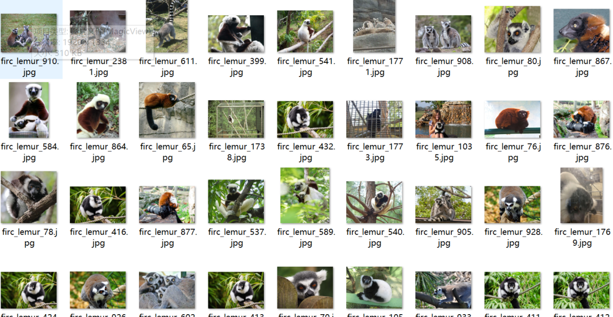
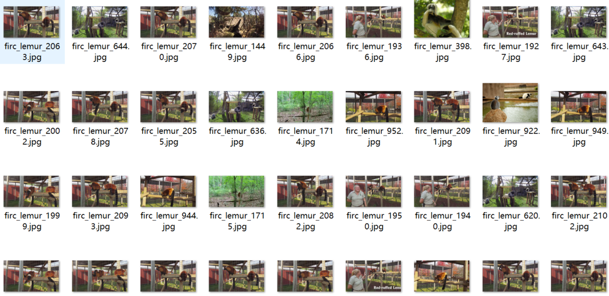
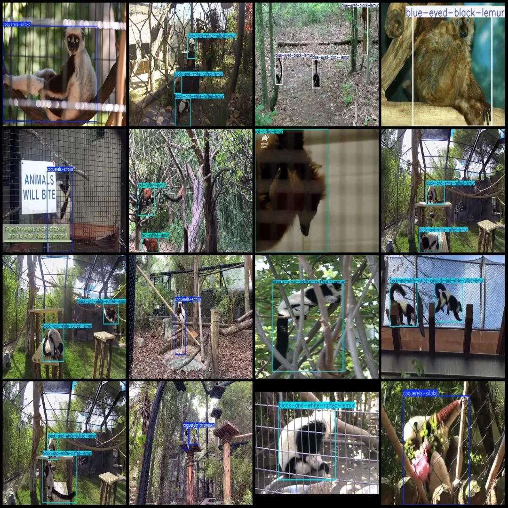
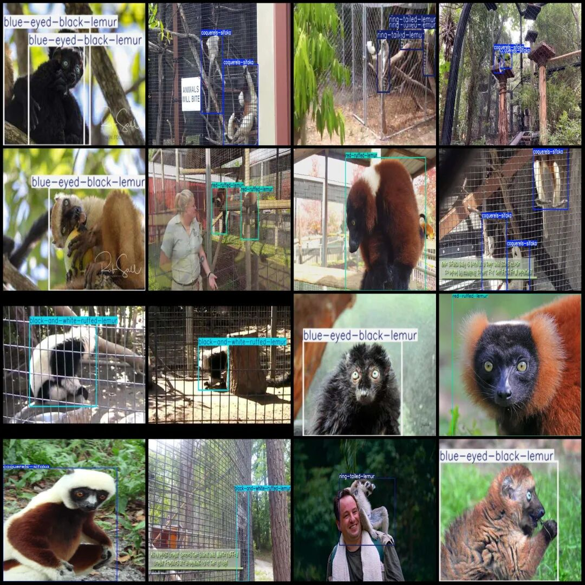

# Feline Monkey Species Classification Dataset VOC+YOLO format with 2381 images in 5 categories

Dataset format: Pascal VOC format + YOLO format (txt file without split path, only containing jpg images and corresponding VOC format xml files and yolo format txt files)

Number of images (number of jpg files): 2381

Number of annotations (number of xml files): 2381

Number of annotations (number of txt files): 2381

Label category count: 5

Label category names (Note that the order of categories in the YOLO format does not correspond to this, but is based on the classes.txt file in the labels folder): ["black-and-white-ruffed-lemur", "blue-eyed-black-lemur", "coquerels-sifaka", "red-ruffed-lemur", "ring-tailed-lemur"]

Number of boxes labeled in each category:

Black-and-white-ruffed-lemur (black-and-white ruffed lemur) frame count = 1230

Blue-eyed Black Lemur (blue-eyed black lemur) frame count = 558

Coquerels-sifaka (Kori's crested guenon) frame count = 794

Red-ruffed Lemur (646)

Ring-tailed Lemur (287)

Total frame count: 3515

Number of images per category:

Black-and-white ruffed lemur (black-and-white ruffed lemur) occupies the image count = 814

Blue-eyed Black Lemur (blue-eyed black lemur) has 451 images.

coquerels-sifaka (Coquerelus sifaka) has 527 images.

Number of images for red-ruffed lemur = 411

Ring-tailed Lemur (191)

Image resolution: Multi-resolution images, such as 165x239, 319x213, etc.

Using labelImg:

Annotation rules: Draw a rectangle around the category.

Important Notice: The dataset does not have separate training, validation, and test sets; you need to partition them yourself.

Special : This dataset does not guarantee the accuracy of the trained models or weight files.

Image Preview:

Annotation example:

## Payment

Here is a pay link on Stripe ( https://buy.stripe.com/3cs8yP7sY87d0vu9AB ). Please contact me lonlonago@foxmail.com after funding $89, and I will send you a complete data files , thank you!

